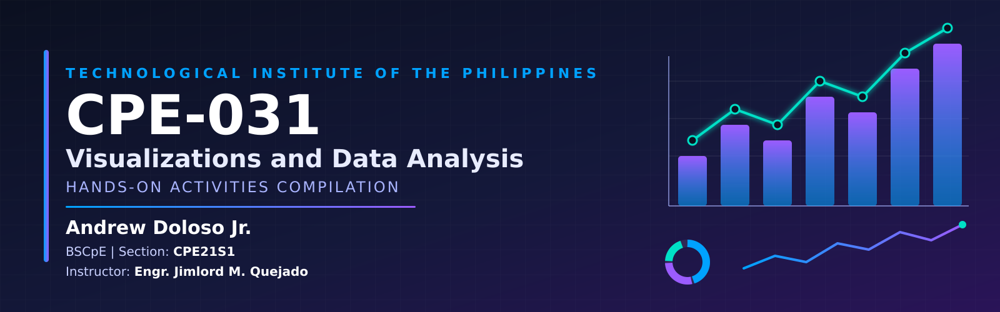

  <div align="center">

  # CPE-031: Visualizations and Data Analysis
  ### Hands-on Activities Compilation
  
   

   
   
   
   
  
   ___
   
   ___

   </div>
   
   
 

## Description
   - this repository was created as a primary documentation and submission for the course *CPE 031 - Visualizations and Data Analysis*.
  
   ___
  
## Contents
   ```
   Portfolio_in_CPE-031/
   │
   ├── README.md        # You are here
   ├── PRELIM/          # Prelim period activities
   ├── MIDTERM/         # Midterm period activities
   ├── FINALS/          # Finals period activities
   ```

   ---

## About this Course
   -                     

___

## Instructor
   - Engr. Jimlord Quejado
  
   ___
  
## Student Information

   | | |
   |---|---|
   | **Name** | Andrew Doloso Jr. |
   | **Program** | Bachelor of Science in Computer Engineering (BSCpE) |
   | **School** | Technological Institute of the Philippines (T.I.P.) |
   | **Course** | CPE-010 – Data Structures and Algorithms |
   | **GitHub** | [@Dolosojrcpe](https://github.com/Dolosojrcpe) |
   | **Email** | qadolosojr@tip.edu.ph |

   ---

   ## Files Directory

   ### [PRELIM](./PRELIM)
   Foundations and introductory data structures.

   | Activity | Topic | Description |
   |---|---|---|
   | Hands-on Activity 1.1 | 1 | Short description |
   | Hands-on Activity 2.1 | 2 | Short description |
   | Hands-on Activity 3.1 | 3 | Short description |
   | Hands-on Activity 4.1 | 4 | Short description |
   | Hands-on Activity 5.1 | 5 | Short description |
   ### [MIDTERM](./MIDTERM)
   Linear data structures.

   | Activity | Topic | Description |
   |---|---|---|
   | Hands-on Activity 6.1 | 6 | Short description |
   | Hands-on Activity 7.1 | 7 | Queue implementation and operations |
   | Hands-on Activity 8.1 | 8 | Short description |
   | Hands-on Activity 9.1 | 9 | Short description |
   ### [FINALS](./FINALS)
   Advanced data structures and algorithms.

   | Activity | Topic | Description |
   |---|---|---|
   | Hands-on Activity 10.1 | 10 | Short description |
   | Hands-on Activity 11.1 | 11 | Short description |
   | Hands-on Activity 12.1 | 12 | Short description |
   | Hands-on Activity 13.1 | 13 | Short description |
   | Hands-on Activity 14.1 | 14  | Short description |
   | Final Project | Project name | Short description |
   ---

   ## Topics Covered

   - [x]  
   - [x]  
   - [x] 
   - [x] 
   - [x]  
   - [x]  
   - [x] 
   
   ---

   ## Contact

   - GitHub: [@Dolosojrcpe](https://github.com/Dolosojrcpe)
   - Email: qadolosojr@tip.edu.ph

   ---
   
   <div align="center"> 
    
   ## THANK YOU!

   </div>
   
    
